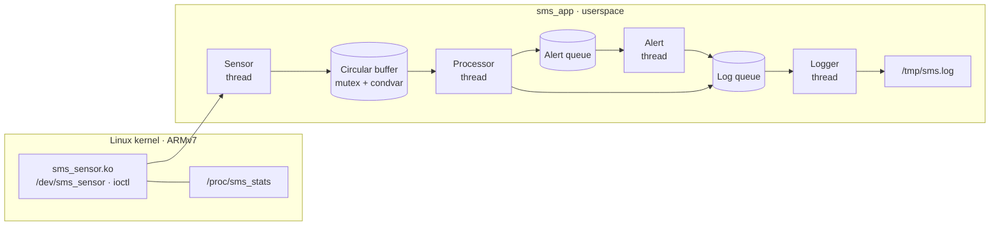

<div align="center">

# ⚙️ LOS201 · IC2009
### EMBEDDED LINUX ENGINEERING PORTFOLIO

**From bootloaders and kernel modules to debugging, multithreading and real-time measurements.**

<sub>Hands-on coursework · ARMv7 / Cortex-A9 · QEMU · Linux 5.15 · C</sub>

<br><br>


**[⭐ Assignment 02](SE203134_Assignment02/)** · **[📖 Final Report](SE203134_Assignment02/05_Final_Report/SE203134_Asgn02_BaoCao_FINAL.pdf)** · **[🛠️ LAB 03](SE203134_Lab03/)** · **[🔍 Browse all modules](#coursework--project-map)**

</div>

---

## ✦ The project, at a glance

This repository documents the **LOS201 / IC2009 Embedded Linux Systems** coursework—from building an ARM Linux environment to implementing and evaluating a four-thread sensor monitoring application.

The goal is not only to show *what was built*, but also **how it was tested**: source, build artifacts, console transcripts, performance measurements and reports are organized under student-ID folders.

| 🧱 **BUILD** | 🧪 **VERIFY** | ⏱️ **MEASURE** |
|:---|:---|:---|
| ARM cross-compilation, U-Boot, Linux kernel, BusyBox and initramfs | Character drivers, ioctl, procfs/sysfs, GDB, Valgrind, strace | perf, scheduling latency, SCHED_FIFO vs SCHED_OTHER, memory footprint |
| [Explore LAB 01 →](SE203134_Lab01/) | [Explore LAB 02 →](SE203134_Lab02/) | [Explore LAB 03 →](SE203134_Lab03/) |

---

## 🌟 Capstone spotlight — Assignment 02

### Multi-threaded Sensor Monitoring System

A Linux 5.15 **ARM kernel sensor driver** and an application with four worker threads: **Sensor, Processor, Alert and Logger**. It combines a mutex/condition-variable circular buffer, POSIX message queues, timestamped logs, graceful shutdown, and real-time scheduling experiments.



### Verified results · Evidence-backed

| Metric | Recorded result | Evidence |
|:---|:---|:---|
| **60-second, 500 ms run** | **116 produced / 116 consumed**, buffer size 0, overflow 0 | [Final report](SE203134_Assignment02/05_Final_Report/SE203134_Asgn02_BaoCao_FINAL.pdf) |
| **Driver integration** | ioctl, read, EOF and EAGAIN checks passed | [Task 2 evidence](SE203134_Assignment02/02_Evidence/Task_02_Memory_and_Driver/) |
| **Valgrind** | 0 errors; heap blocks freed on shutdown | [Full Valgrind log](SE203134_Assignment02/02_Evidence/Task_02_Memory_and_Driver/valgrind_sms.txt) |
| **Real-time benchmark** | FIFO P99 **9,736 µs** vs OTHER **9,939 µs** (**2.04% lower**) | [Jitter report](SE203134_Assignment02/02_Evidence/Task_04_RealTime_Jitter/jitter_report.txt) |
| **Debug & profiling** | GDB thread inspection, strace syscall analysis and live perf attempt | [Task 3 evidence](SE203134_Assignment02/02_Evidence/Task_03_Debugging_and_Profiling/) |

> **Measurement context:** The P99 comparison uses a **100 ms benchmark** with 1,000+ samples per policy, not the 500 ms functional test. The live application's perf report captured just **one CPU sample**, so it does **not** support a reliable hotspot ranking. QEMU timing is not a hard real-time guarantee on physical hardware.

<div align="center">

**[📁 Explore source & evidence](SE203134_Assignment02/)** &nbsp;·&nbsp;
**[📕 Read the final technical report](SE203134_Assignment02/05_Final_Report/SE203134_Asgn02_BaoCao_FINAL.pdf)**

</div>

---

## 📚 Coursework & project map

### SE203134 · Lab sequence and assignments

| Module | Engineering focus | Open |
|:---|:---|:---|
| **LAB 01** · Bring-up | Cross-toolchain, kernel configuration, U-Boot, BusyBox, ARM/QEMU boot | [Explore →](SE203134_Lab01/) |
| **LAB 02** · Kernel interfaces | Character-device driver, ioctl, procfs/sysfs, synchronization, JFFS2/MTD exercises | [Explore →](SE203134_Lab02/) |
| **LAB 02 — Practice 20Q** | Extended driver practice and tests | [Explore →](SE203134_Lab02-Practice-20Q/) |
| **Assignment 01** · Drivers | ioctl character driver, counter driver, kernel modules and test logs | [Explore →](SE203134_Assignment01/) |
| **Exam R1–R3** · Sensor extensions | Total bytes read, temperature extrema and circular-buffer shutdown statistics | [Explore →](SE203134_Exam_R1_R2_R3/) |
| **LAB 03** · Debug & performance | GDB/gdbserver, Valgrind, strace, perf, cyclictest and latency visualizations | [Explore →](SE203134_Lab03/) |
| **Assignment 02** · Capstone | Multi-threaded sensor monitoring, driver integration, memory and RT measurements | **[Explore →](SE203134_Assignment02/)** |

### Other contributor workspaces

These folders are maintained under their **own student-ID prefixes** to preserve authorship and avoid mixing independent work.

| Folder | Material |
|:---|:---|
| [`SE203529_Lab2/`](SE203529_Lab2/) | LAB 02 driver code, build outputs and test logs |
| [`SE204186_Lab02-Practice-20Q/`](SE204186_Lab02-Practice-20Q/) | Contributed driver and ioctl practice files |

---

## 🔬 Evidence over claims

Our workflow follows a simple engineering principle:

```text
CONFIGURE  →  BUILD  →  BOOT  →  INSTRUMENT  →  VERIFY  →  DOCUMENT
   ARM         .ko       QEMU     GDB/strace     logs       reports
```

A few concrete artifacts to explore:

- **[LAB 03 — full remote GDB transcript](SE203134_Lab03/02_Evidence/Part_A_GDB/A05_A09_GDB_debugging/gdb_session_full.txt):** stepping through array bounds, memory lifetime and integer-overflow issues.
- **[LAB 03 — Valgrind after fixes](SE203134_Lab03/02_Evidence/Part_B_Valgrind/B02_Memory_leaks_after_fix/valgrind_fixed.txt):** memory-leak cleanup with a zero-error final run.
- **[Assignment 02 — memory snapshots](SE203134_Assignment02/02_Evidence/Task_02_Memory_and_Driver/):** VmRSS/VmSize measurements and driver statistics.
- **[Assignment 02 — complete report](SE203134_Assignment02/05_Final_Report/SE203134_Asgn02_BaoCao_FINAL.pdf):** architecture, methodology, results, limitations and lessons learned.

---

## 🧰 Reproduce the environment

| Component | Environment |
|:---|:---|
| Target architecture | ARMv7 / Cortex-A9 |
| QEMU machine | `vexpress-a9` |
| Linux kernel | 5.15 |
| Minimal userspace | BusyBox / initramfs |
| Languages & interfaces | C, pthreads, POSIX message queues, ioctl, procfs, sysfs |
| Tooling | ARM GNU toolchain, GDB/gdbserver, Valgrind, strace, perf, cyclictest |

**Get the repository:**

```bash
git clone https://github.com/ttminhhayamin/LOS201_IC2009.git
cd LOS201_IC2009
```

**Explore the capstone:**

```bash
cd SE203134_Assignment02
ls 01_Source 02_Evidence 03_Binaries 04_QEMU 05_Final_Report
```

The packaged Assignment 02 source and binaries can be inspected immediately. **Rebuilding kernel modules** requires a compatible configured Linux 5.15 ARM kernel tree and cross-compiler. **Booting QEMU** also requires the matching `zImage` and DTB, which are not bundled in the Assignment 02 folder. See its [build and QEMU notes](SE203134_Assignment02/README.md) for details.

---

## 👥 Team & repository conventions

**LOS201 · IC2009** — original team roster: **Minh · Khoa · Tuan**.

- **Student-ID directory naming** preserves contributor boundaries (for example, `SE203134_...`, `SE203529_...` and `SE204186_...`).
- **Evidence is grouped by task** wherever applicable: original console logs, measurements, source, compiled artifacts and reports remain identifiable.
- **Reproducibility matters:** recorded measurements are presented with their environment and limitations rather than as universal hardware guarantees.

<div align="center">

---

<sub>**Build carefully. Debug methodically. Measure honestly.**</sub>

**LOS201 · IC2009 — Embedded Linux Systems**

</div>
